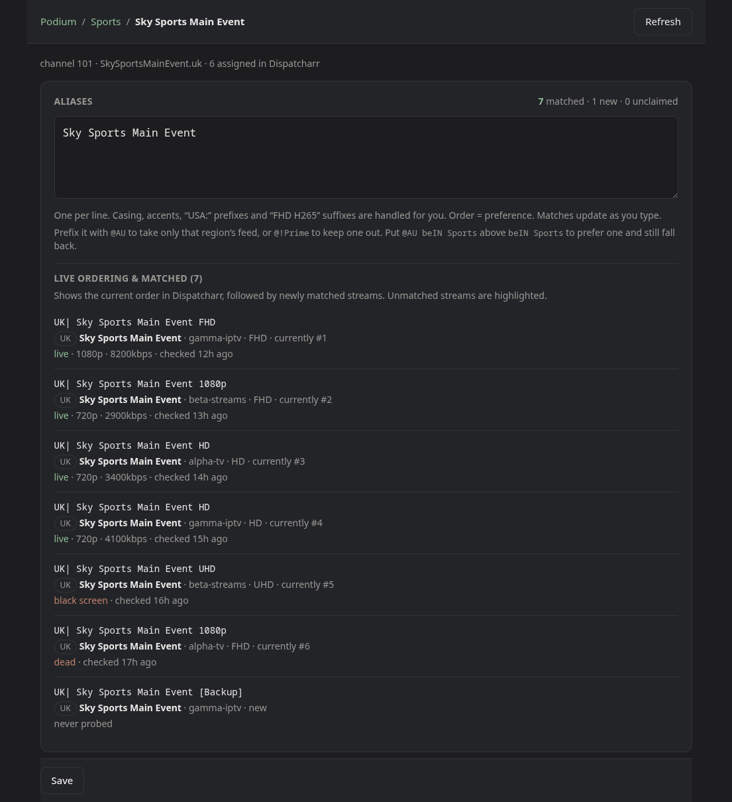
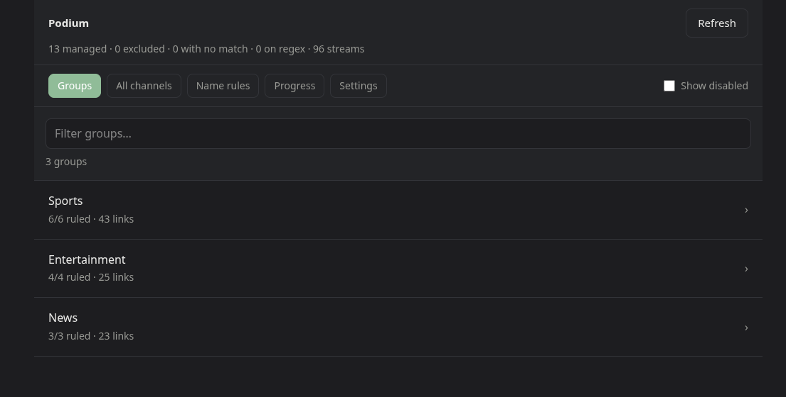
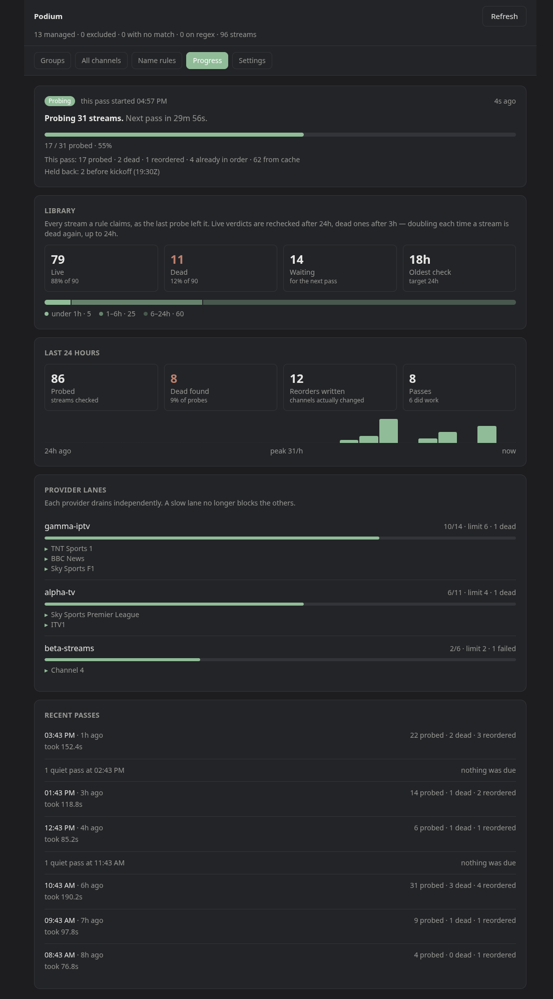

# Podium

Podium ranks the streams behind your [Dispatcharr](https://github.com/Dispatcharr/Dispatcharr) channels, best first, by measuring them instead of trusting their names.

It fetches your channels and streams, matches each stream to a channel, and probes each stream with `ffprobe` and `ffmpeg`. It then writes the ranked order back to Dispatcharr. It runs in one container with one volume.



The screenshot shows one channel, its streams in the order that Dispatcharr serves them, and what each stream measures. The stream named `1080p` at #2 measures 720p. The stream named `UHD` at #5 is a black screen, and #6 is dead. Matches update as you edit, and Podium writes nothing until you save.

## Quick start

Run Podium in Docker:

```sh
docker run -d -p 127.0.0.1:3456:3456 -v podium-data:/app/data \
  -e DISPATCHARR_URL=http://dispatcharr:9191 \
  -e DISPATCHARR_API_KEY=... \
  ghcr.io/lpukatch/podium:latest
```

This command binds port `3456` on the loopback address only. If you want to reach Podium from another host, remove `127.0.0.1:` from the `-p` flag. Read [who can reach it](docs/configuration.md#who-can-reach-it) before you expose the port. Podium has no login and holds a Dispatcharr credential.

You can also run `docker compose up -d` with the [compose file](docker-compose.yml) in this repository.

On first start, Podium writes an empty rules file and has no channels to probe. Open the UI on port `3456`, select a group, and add channels. You can also [import rules you already have](docs/usage.md#importing-existing-rules).

If your lineups are already set in Dispatcharr, set a group to [`assigned`](docs/usage.md#channel-groups). Podium then ranks every channel in that group from the streams that Dispatcharr already assigned to it, with no rules to write.



Podium needs no credentials to start. If you do not want to put an API key in your environment, omit `DISPATCHARR_API_KEY`. Enter the key on the Settings page after Podium starts.

> [!IMPORTANT]
> Podium starts in dry-run mode by default. Reordering a channel in Dispatcharr is a write with no undo, so Podium watches and records first. Set `PODIUM_DRY_RUN=false` after you see a few passes that you agree with.

## Why it exists

Provider stream names are often wrong. A stream labeled `[1080p]` can measure 720p, and another can deliver 193kbps of black screen. The only reliable way to rank streams is to probe them.

Probing costs provider connections. Every probe uses a connection from your provider limit, and providers disconnect clients that open too many at once. Podium manages that connection budget across your providers.

### Provider lanes instead of a channel queue

Providers have different concurrency limits. If you probe channel by channel, one full provider stalls the queue while other providers sit idle. Podium treats a stream as the unit of work and gives each provider its own lane. This cuts hours off a full pass on a multi-provider catalogue.

Extra logins saved as profiles on a Dispatcharr M3U account also get their own lanes. Podium pools these lanes so their connection limits add up. Each stream uses one login. A 3-connection login and a 2-connection login together probe five streams at a time.

### Caching against `stream_hash`

Provider stream lists rarely change between runs, so repeated probes waste connections. Podium re-probes a stream only when its `stream_hash` in Dispatcharr changes or when its verdict expires. Podium ignores `updated_at` because the M3U refresh updates it on every stream every few minutes.

### Pacing against a freshness target

You want every channel checked within 24 hours, using only spare provider capacity, and stopping when someone starts watching. A nightly batch hits every provider even when someone is streaming, and if it runs late it is still running in the morning.

The freshness target is a floor, not a guarantee of recent data. All streams can be inside the 24-hour window and still date from four in the morning before a big game. You can [queue a channel, a group, or the whole catalogue for a re-check](docs/usage.md#re-checking-on-demand) regardless of the cache. Queuing lets the paced pass do the work. If you cancel the re-check, Podium restores the previous verdicts.



The Progress page shows all three views together. Each provider lane drains against its own limit, and the library tiles show how much of the catalogue is inside the freshness target. If a channel's EPG (electronic program guide) shows that the event starts later, Podium holds that channel instead of probing it.

## What it measures

Podium scores and weights resolution, bitrate, frame rate, and codec, while your own rule order always wins first. Dead streams, streams below a bitrate floor, and streams that show a black screen move to the bottom. A black screen or slate never acts as a fallback.

Podium measures bitrate directly instead of reading container metadata, because live TS and HLS streams rarely declare a bitrate. It reads a few seconds of each stream and runs the black-screen check on the same read. Both checks together cost one provider connection.

By default, Podium probes the provider directly for the fastest and cheapest reading. If you turn on "Probe through Dispatcharr" in Settings, Podium probes through Dispatcharr's proxy instead. Each probe then uses the stream's profile and measures what a viewer receives, including the account's user agent, proxy mode, and any transcode. This option is off by default because each probe acts as a Dispatcharr client that holds a provider connection. Read [the trade-offs for probing through Dispatcharr](docs/configuration.md#probing-and-soaking-through-dispatcharr).

Podium does not include loop detection. Catching a video loop requires watching a stream for at least one loop period. That takes around 120 seconds per stream, compared to ~1 second for the other checks.

## Who can reach it

Podium has no login because it manages one Dispatcharr instance on your local network. It blocks two external paths that can reach a local service: cross-site writes from a browser page, and hostnames that resolve to your LAN address. Podium rejects cross-site writes and answers only to private addresses and names, plus hosts you list in `PODIUM_ALLOWED_HOSTS`.

Those protections do not make Podium safe to expose to the internet. Anyone who can reach the port can reorder your channels, and Podium holds a Dispatcharr credential. Keep Podium on your local network. If you expose it anywhere else, set `PODIUM_AUTH_TOKEN` and read [who can reach it](docs/configuration.md#who-can-reach-it).

## Documentation

| Guide | Contents |
| --- | --- |
| [Usage](docs/usage.md) | Matching streams to channels, section qualifiers, group policy, ranking, and importing existing rules |
| [Reading every verdict](docs/usage.md#reading-every-verdict) | `GET /api/verdicts`: returns every managed channel's streams in slot order, with each stream's cached verdict and latest soak (stability check) |
| [Reading probe history](docs/usage.md#reading-probe-history) | `GET /api/probe-history`: returns recent verdicts for chosen streams or since a given time, kept for 30 days and 100 entries per stream |
| [Quality priors and the Teamarr export](docs/usage.md#exporting-what-podium-learned) | Ranking unmeasured streams from past account and name quality, exporting Teamarr scoring rules, and comparing existing Teamarr rules |
| [Configuration](docs/configuration.md) | Environment variables, network access, concurrency limits, webhook notifications, and keeping a settled install quiet |
| [Metrics and Grafana](docs/configuration.md#metrics) | Scraping `/api/metrics`, comparing providers, and importing the [example dashboard](docs/grafana/podium-provider-quality.json) |
| [Name miner](docs/miner.md) | Learning `regex` rules from stream names, including thresholds, guards, and evidence |
| [Contributing](CONTRIBUTING.md) | Development setup and how pull requests land through the mirror |

## Development

Run the following commands to install dependencies, start the UI and worker, and run the tests:

```sh
npm install
npm run dev            # UI on :3456
npm run worker         # the paced loop
npm run test:run
```

The UI runs on port `3456`, and the worker runs the paced probe loop. Make sure that `ffmpeg` is on your `PATH` before you run the tests, because without it the tests skip the real `ffprobe` path.

## Contributing

Issues and pull requests are welcome. Development happens on a self-hosted Forgejo instance, and GitHub is a push mirror. Maintainers land pull requests by replaying commits upstream instead of merging on GitHub, as described in [CONTRIBUTING.md](CONTRIBUTING.md).

Container images `:latest` and `:X.Y.Z` are releases, while `:main` tracks the tip of `main` on every push (`linux/amd64` and `linux/arm64`).

## License

Podium uses the MIT license. See [LICENSE](LICENSE) for the full text.
